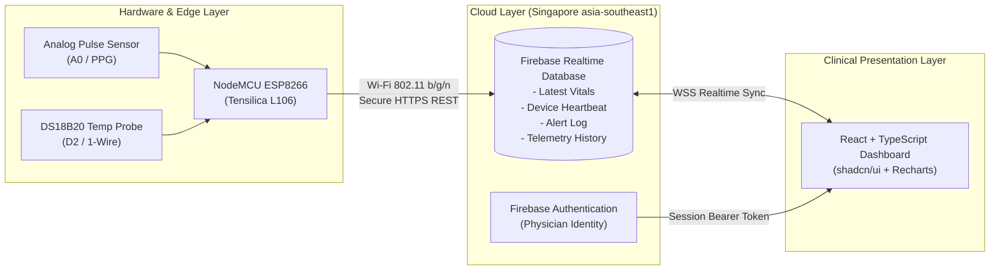

# IoT-Based Patient Health Monitoring System

[](#documentation-index)
[](https://github.com/captainJosh-1/iot-patient-health-monitoring)
[](docs/HARDWARE.md)
[-orange.svg)](docs/DATABASE_SCHEMA.md)
[](docs/ARCHITECTURE.md)

An end-to-end biomedical telemetry prototype designed to continuously acquire physiological vitals from a patient, transmit real-time telemetry over Wi-Fi to Google Firebase Realtime Database, and present live vitals, historical trends, and anomaly alerts on an authenticated clinical web dashboard for attending physicians.

---

## 1. System Overview & Monitored Parameters

The system monitors two vital physiological signs in real time:
1. **Heart Rate (BPM):** Captured via an optical Analog Pulse Sensor (photoplethysmography / PPG) connected to the NodeMCU analog input pin (`A0`).
2. **Body Temperature (°C):** Captured via a digital DS18B20 waterproof temperature probe interfaced via Dallas 1-Wire protocol on `D2` (`GPIO4`).

Edge telemetry is processed on the NodeMCU ESP8266 and transmitted over standard Wi-Fi to **Google Firebase Realtime Database** in the Singapore region (`asia-southeast1`). An authenticated single-page application built with **React, TypeScript, Vite, Tailwind CSS, shadcn/ui, and Recharts** provides continuous oversight for an attending physician.



---

## 2. Technology Stack

- **Microcontroller & Firmware:**
  - NodeMCU ESP-12E (ESP8266 SoC, 80/160 MHz, 4MB Flash)
  - C++ for ESP8266 using Arduino Core
  - DallasTemperature & OneWire digital communication libraries
- **Cloud Infrastructure:**
  - Google Firebase Authentication (Email/Password Physician Sign-in)
  - Google Firebase Realtime Database (Singapore region `asia-southeast1`, deployed in Locked Mode)
- **Clinical Frontend Dashboard:**
  - React 18+ Single Page Application with TypeScript
  - Vite for development and optimized production bundling
  - Tailwind CSS for styling and clinical theme design
  - shadcn/ui (Radix UI primitives) for accessible component architecture
  - Recharts for composable SVG historical trend visualization
  - Lucide React for medical and status iconography
- **Development Tools & Version Control:**
  - Git & GitHub
  - Google Antigravity

---

## 3. Key System Capabilities

- **Secure Doctor Login:** Single-physician authentication powered by Firebase Auth, protecting clinical data behind secured route guards.
- **Instantaneous Vitals Stream:** Sub-second telemetry updates displaying Heart Rate (BPM) and Body Temperature (°C) with last-updated timestamp.
- **Dynamic Physiological Classification:** Evaluates vitals against configurable demonstration thresholds into `NORMAL`, `WARNING`, and `ABNORMAL` states.
- **Historical Trend Visualization:** Interactive time-series charts displaying real-time and historical telemetry over time with clinical reference boundaries.
- **Clinical Anomaly Alerts:** Automated generation, visual notification, and chronological audit log of threshold breaches.
- **Deterministic Heartbeat & Stale Data Detection:** Continuous client-side monitoring of device timestamps to clearly differentiate between active hardware telemetry and network/device disconnection (auto-tagging stale data after 30 seconds).

---

## 4. Strict Project Scope & Exclusions

To ensure academic rigor, software stability, and strict alignment with project boundaries:
- **One Physician Account:** Dedicated single-doctor clinical oversight.
- **One Monitored Patient:** Focused single-bed telemetry profile (`patient_01`).
- **One Hardware Unit:** Single NodeMCU ESP8266 monitoring device (`esp8266_01`).
- **Strictly Excluded:**
  - ❌ No Fall detection or motion tracking (MPU6050 is strictly excluded).
  - ❌ No ECG waveforms or analog front-ends (AD8232 is excluded).
  - ❌ No Blood oxygen saturation (SpO2) estimation (MAX30100/MAX30102).
  - ❌ No Blood pressure or blood glucose monitoring.
  - ❌ No Artificial Intelligence or Machine Learning disease diagnosis.
  - ❌ No Multi-patient management or hospital ward administration.
  - ❌ No Patient/family login portals.
  - ❌ No Appointments, e-prescriptions, or medical billing systems.
  - ❌ No auxiliary backend servers (Express, MongoDB, PostgreSQL, etc.).

---

## 5. Documentation Index

Comprehensive technical documentation is maintained under the [`docs/`](docs/) directory:

| Document | Description |
|---|---|
| [**Project Specification**](docs/PROJECT_SPEC.md) | Problem statement, motivation, functional & non-functional requirements, limitations, and scope boundaries. |
| [**System Architecture**](docs/ARCHITECTURE.md) | Component architecture, communication protocols, edge processing, security model, and Mermaid flow diagrams. |
| [**Development Plan**](docs/DEVELOPMENT_PLAN.md) | Phased, module-by-module implementation roadmap from repository setup to final demonstration. |
| [**Database Schema**](docs/DATABASE_SCHEMA.md) | Normalized Firebase Realtime Database JSON schema, data types, sample payloads, and security rules. |
| [**Hardware Specifications**](docs/HARDWARE.md) | Bill of materials, electrical characteristics, ADC voltage scaling, DS18B20 pull-up wiring, and bench testing procedures. |
| [**AI Agent Guidelines**](AGENTS.md) | Mandatory architectural boundaries, coding rules, and conventions for AI assistants. |
| [**Development Progress Tracker**](PROGRESS.md) | Live milestone tracking matrix reflecting real-time phase completion status. |

---

## 6. Repository Layout

```
iot-patient-health-monitoring/
│
├── docs/                           # Engineering and architecture documentation
│   ├── PROJECT_SPEC.md             # Functional & system requirements
│   ├── ARCHITECTURE.md             # System architecture & Mermaid diagrams
│   ├── DEVELOPMENT_PLAN.md         # Phased implementation roadmap
│   ├── DATABASE_SCHEMA.md          # Firebase Realtime Database schema & rules
│   └── HARDWARE.md                 # Pinout, electrical characteristics & testing
│
├── frontend/                       # React + TypeScript + Vite clinical dashboard (scaffold)
│   └── README.md                   # Frontend architecture notes
│
├── firmware/                       # Edge microcontroller source code
│   └── esp8266/                    # NodeMCU C++ firmware (scaffold)
│       └── README.md               # Firmware architecture & pin notes
│
├── AGENTS.md                       # Instructions & constraints for AI coding agents
├── PROGRESS.md                     # Phase completion tracking table
├── .gitignore                      # Ignore rules for Node, Vite, Firebase, and C++
└── README.md                       # Main project introduction (this document)
```

---

## 7. Git & GitHub Workflow Protocol

This project is maintained on GitHub at [`https://github.com/captainJosh-1/iot-patient-health-monitoring.git`](https://github.com/captainJosh-1/iot-patient-health-monitoring.git).

All collaborators and AI development assistants must strictly adhere to this sequential 8-step workflow protocol:
1. **Work on a complete feature or development milestone:** Implement cohesive modules strictly within the approved project scope.
2. **Run the application and test the completed feature:** Verify local execution (`npm run dev`) and production compilation (`npm run build`).
3. **Fix errors before considering the milestone complete:** Eliminate all TypeScript, lint, build, and runtime errors.
4. **Review all modified and newly created files:** Perform a full audit using `git status` and `git diff`.
5. **Check that secrets, API keys, credentials, and `.env` files are not committed:** Ensure `.env` and `.env.local` files remain gitignored. Keep `.env.example` sanitized.
6. **Present the proposed commit message and changed-file summary to the user:** Provide conventional commit messages (`feat:`, `fix:`, `docs:`).
7. **Wait for explicit user approval before creating a local commit:** Never run `git commit` automatically without explicit user authorization.
8. **After the local commit, wait for separate explicit user approval before pushing to GitHub:** Remote pushes (`git push origin <branch>`) require a separate, explicit user instruction.

---

## 8. Current Project Phase & Next Steps

- **Completed Phases:**
  - **Phase 1 Complete:** Repository Initialization & Architectural Documentation (Committed: `8d77ef5`).
  - **Phase 2 Complete:** Frontend Foundation & Component Library Setup (Verified build: `0 errors`).
  - **Phase 4 Complete:** Patient Monitoring Dashboard Layout & Mock UI (Verified responsive layout & charts).
- **Next Phase:** **Phase 3 (Doctor Authentication Module & Route Protection)**.
  - Installing Firebase Client SDK in `frontend/`.
  - Configuring `.env.example` for Firebase Auth keys.
  - Building `AuthContext`, `LoginForm`, `LoginPage`, and `ProtectedRoute`.
  - Implementing physician session logout control.
