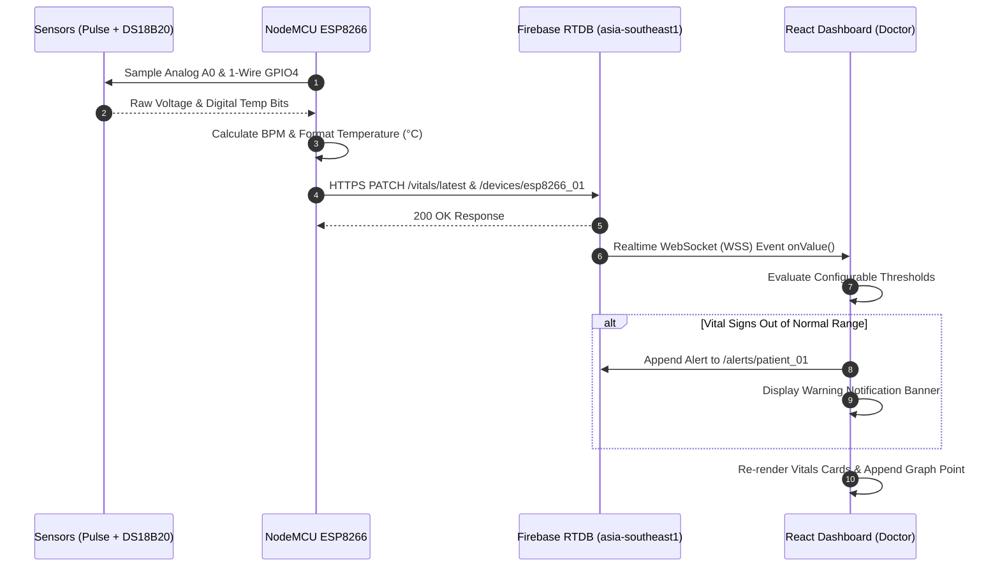
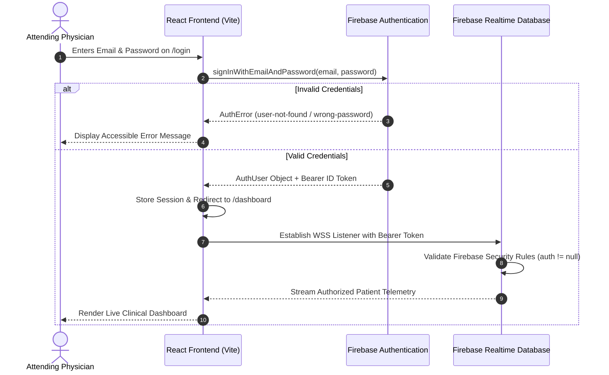
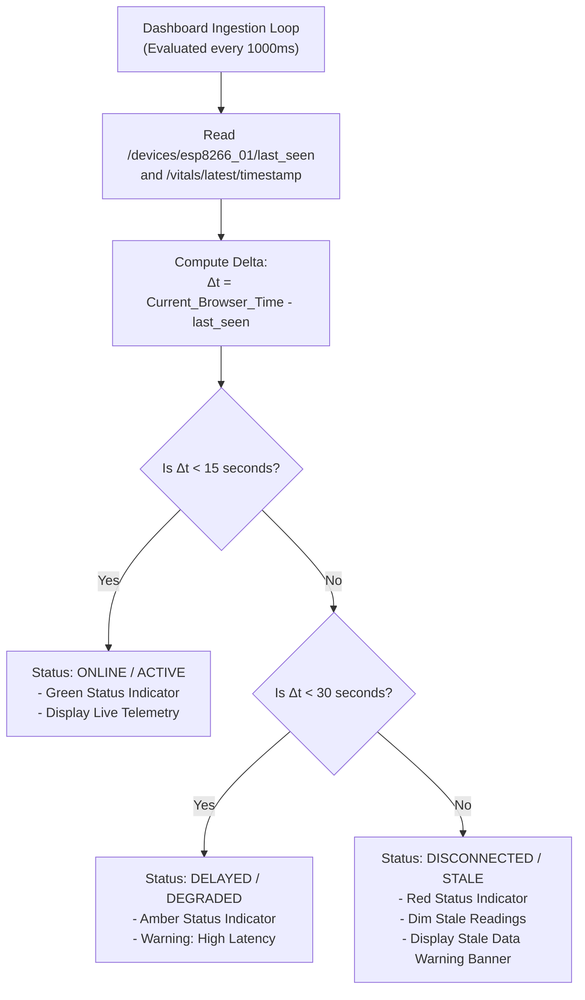

# System Architecture: IoT-Based Patient Health Monitoring System

**Document Version:** 1.0.0  
**Status:** Approved Architecture  
**Target Environment:** Academic Demonstration Prototype  

---

## 1. Architectural Overview

The **IoT-Based Patient Health Monitoring System** utilizes a distributed three-tier architecture:
1. **Physical Sensing & Edge Computing Tier:** NodeMCU ESP8266 microcontroller acquiring and conditioning physiological signals from an Analog Pulse Sensor and a Dallas DS18B20 digital temperature probe.
2. **Cloud Synchronization & Persistence Tier:** Google Firebase Realtime Database hosted in the Singapore region (`asia-southeast1`) providing low-latency document streaming and Firebase Authentication providing identity security.
3. **Clinical Presentation & Visualization Tier:** A responsive Single Page Application (SPA) built with React 18, TypeScript, Tailwind CSS, shadcn/ui, and Recharts, subscribing to real-time database nodes via WebSockets (WSS).

```mermaid
flowchart TD
    subgraph Hardware_Tier ["Hardware & Edge Sensing Tier"]
        PS["Analog Pulse Sensor\n(Optical PPG on A0)"] -->|Analog Voltage 0-3.3V| MCU["NodeMCU ESP8266\n(Tensilica L106 Core)"]
        TS["DS18B20 Temp Probe\n(Waterproof on GPIO4/D2)"] -->|1-Wire Digital Bus| MCU
        PULLUP["4.7kΩ Pull-Up Resistor"] -.->|VCC to DATA| TS
    end

    subgraph Cloud_Tier ["Cloud Tier (Google Firebase asia-southeast1)"]
        FA["Firebase Authentication\n(Physician Identity Service)"]
        RTDB[("Firebase Realtime Database\n- /vitals/latest\n- /vitals/history\n- /devices/esp8266_01\n- /alerts\n- /thresholds")]
    end

    subgraph Client_Tier ["Presentation Tier (Doctor Dashboard)"]
        AUTH_ROUTER["Protected Auth Route / Login"]
        DASH["React + TypeScript Dashboard\n(shadcn/ui + Tailwind CSS)"]
        CHARTS["Recharts Time-Series Engine\n(BPM & Temp Trends)"]
        ALERT_ENG["Alert Evaluation & Audit Log"]
        HEARTBEAT_MON["Device Connectivity & Stale Data Monitor"]
    end

    MCU -->|Wi-Fi 802.11 b/g/n\nTLS / REST HTTPS POST| RTDB
    FA -->|Auth State & JWT Token| AUTH_ROUTER
    AUTH_ROUTER --> DASH
    RTDB <-->|WSS Realtime Sync Listener\n(Firebase JS SDK v10+)| DASH
    DASH --> CHARTS
    DASH --> ALERT_ENG
    DASH --> HEARTBEAT_MON
```

---

## 2. Hardware Architecture & Edge Processing

### 2.1 Microcontroller Unit (MCU): NodeMCU ESP8266 (ESP-12E)
- **Processor:** 32-bit Tensilica Xtensa L106 running at 80 MHz (configurable to 160 MHz).
- **Memory:** 64 KB Instruction RAM, 96 KB Data RAM, 4 MB External SPI Flash.
- **Wireless Networking:** Built-in 2.4 GHz 802.11 b/g/n Wi-Fi transceiver with onboard PCB trace antenna.
- **Operating Voltage:** 3.3V DC logic level. Power is supplied via 5V Micro-USB, regulated onboard to 3.3V by an AMS1117-3.3 LDO regulator.

### 2.2 Sensor Interfacing

#### 1. Analog Pulse Sensor (Heart Rate - Optical PPG)
- **Principle:** Reflective photoplethysmography (PPG). An onboard green LED (565nm peak wavelength) illuminates capillary blood flow under the skin. A photodetector measures the alternating reflected light intensity caused by blood pressure pulsations.
- **Interface:** Single Analog Output (Signal) routed to NodeMCU **A0** (ADC0).
- **Voltage Handling:** The Pulse Sensor is powered directly from the NodeMCU **3.3V rail**. The NodeMCU development board features an internal voltage divider (220kΩ / 100kΩ) that scales external 0–3.3V input on the board's A0 pin down to the 0–1.0V internal range of the bare ESP8266 ADC chip. Consequently, running the Pulse Sensor at 3.3V ensures full ADC compliance without over-voltage risks.
- **Firmware Processing:** Sampled using a periodic timer interrupt (every 10–20 ms) to accurately capture diastolic and systolic peaks. Firmware implements dynamic threshold crossing or Inter-Beat Interval (IBI) calculation to yield smoothed Beats Per Minute (BPM).

#### 2. DS18B20 Waterproof Temperature Probe
- **Principle:** Silicon bandgap thermal sensing packaged in a sealed stainless steel tube.
- **Interface:** Dallas 1-Wire serial communication protocol over a single digital GPIO pin (**GPIO4 / D2** on NodeMCU).
- **Pull-Up Resistor:** The 1-Wire bus requires an external **4.7kΩ pull-up resistor** connecting the DATA line to the 3.3V VCC line to maintain bus idle high logic.
- **Resolution:** Configured for 10-bit or 12-bit temperature resolution, providing a measurement accuracy of ±0.5°C across human biological ranges (30°C to 45°C). Conversion duration is approximately 188 ms (10-bit) to 750 ms (12-bit).

---

## 3. Communication Architecture & Data Flows

### 3.1 Edge-to-Cloud Communication Strategy
To transmit telemetry from the ESP8266 to Firebase Realtime Database in Singapore (`asia-southeast1`), two primary architectural approaches were analyzed:

1. **Option A: Firebase ESP8266 Client Library (Token-Based Auth)**
   - Uses Firebase-ESP8266 client library by Mobizt.
   - Requires device authentication via email/password or custom token generation.
   - Supports low-level socket connections and automatic token refresh.

2. **Option B: Firebase Realtime Database REST API over HTTPS**
   - Transmits standard HTTP `PATCH` or `PUT` requests over a secure TLS connection (`WiFiClientSecure`).
   - Uses Firebase Auth REST login (authenticating the device via a dedicated Firebase Auth device credential) or fine-grained Firebase Security Rules with a secure device secret/token passed in headers or URL query parameters.
   - Extremely lightweight, minimal RAM consumption on the ESP8266, zero reliance on complex heavyweight third-party client state engines.

**Architectural Decision:**  
For maximum stability on the single-core ESP8266 and deterministic memory footprint, the firmware will employ **HTTPS REST communication** using `WiFiClientSecure` or the official lightweight `Firebase-ESP-Client` library configured for minimal footprint, authenticating the device via dedicated Firebase Authentication credentials (`device-esp8266@iot-health.internal`) or database-token rules. **Administrator service account keys are strictly prohibited on the microcontroller.**

### 3.2 Telemetry Ingestion Payload Structure
Every 3 to 5 seconds, the ESP8266 compiles a dual-target telemetry update:
1. **Latest Vitals State (`/vitals/latest/patient_01`):** Overwrites current readings for low-overhead dashboard streaming.
2. **Device Heartbeat (`/devices/esp8266_01`):** Updates `last_seen` timestamp and operational metrics.
3. **Periodic Historical Archive (`/vitals/history/patient_01/{pushId}`):** Appended every 10–15 seconds to avoid database bloating while providing sufficient granularity for Recharts historical trends.

```json
{
  "heartRate": 74,
  "temperature": 36.6,
  "timestamp": 1716987450000,
  "deviceId": "esp8266_01",
  "status": "NORMAL"
}
```

### 3.3 End-to-End Live Monitoring Sequence



---

## 4. Presentation Tier Architecture (React Dashboard)

### 4.1 Frontend Architecture & Component Decomposition
The doctor web dashboard is developed as a modular Single Page Application using **React 18** and **TypeScript**, bundled via **Vite**.

```
src/
├── assets/             # Static graphics, logos
├── components/
│   ├── auth/           # Doctor login form, session guards
│   ├── dashboard/      # Patient summary banner, vital cards, trend graphs
│   ├── alerts/         # Alert notification feed, history table
│   ├── ui/             # shadcn/ui primitives (Button, Card, Badge, Table, Dialog)
│   └── common/         # Navbar, StatusPill, ConnectivityIndicator
├── config/
│   ├── firebase.ts     # Firebase App & Database initialization
│   └── thresholds.ts   # Centralized demonstration threshold configuration
├── context/
│   └── AuthContext.tsx # Physician auth session state provider
├── hooks/
│   ├── useVitals.ts    # Firebase RTDB live subscriber hook
│   ├── useAlerts.ts    # Alert history subscriber hook
│   └── useDevice.ts    # Heartbeat & stale data evaluation hook
├── services/
│   ├── firebaseService.ts # Realtime Database read/write helpers
│   └── alertService.ts    # Anomaly evaluation & persistence logic
├── types/
│   ├── vitals.ts       # TypeScript interfaces for vitals, status
│   ├── alerts.ts       # Alert data models
│   └── patient.ts      # Patient & device profile types
└── App.tsx             # Root router & layout wrapper
```

### 4.2 State Management & Real-Time Synchronization
- **Authentication State:** Managed via `AuthContext` powered by Firebase Authentication's `onAuthStateChanged` observer. User tokens are securely managed in browser session storage/cookies by the Firebase SDK.
- **Live Telemetry Stream:** React custom hook `useVitals` attaches a live listener (`onValue`) to `/vitals/latest/patient_01`. When the node changes, React updates state, triggering immediate rerendering of the Heart Rate and Temperature metrics with sub-second visual updates.
- **Historical Charting:** Custom hook fetches `/vitals/history/patient_01` query limited to the last 30 to 50 data points, rendered into smooth, responsive SVG time-series charts using **Recharts**.

---

## 5. Security & Authentication Flow



### 5.1 Database Security Rules Philosophy
The Firebase Realtime Database is deployed in locked mode. The project implements role-based security rules enforcing:
- Read access to `/vitals`, `/devices`, `/patients`, and `/alerts` is **strictly restricted to authenticated physicians** (`auth != null`).
- Write access from the frontend is strictly limited to alert acknowledgments and threshold overrides.
- Device write access to `/vitals/latest`, `/vitals/history`, and `/devices` is constrained to authorized payloads adhering to type and timestamp boundaries.
- Public read or write access is **explicitly blocked**.

---

## 6. Anomaly Classification & Alert Engine

### 6.1 Clinical Demonstration Thresholds
The monitoring engine computes real-time physiological status according to three states:
- **`NORMAL`:** Baseline stable physiological reading.
- **`WARNING`:** Borderline measurement requiring clinical attention.
- **`ABNORMAL`:** Acute deviation indicating potential physiological risk.

| Parameter | NORMAL Range | WARNING Range | ABNORMAL Range |
|---|---|---|---|
| **Heart Rate** | 60 – 100 BPM | 50 – 59 BPM **OR** 101 – 115 BPM | < 50 BPM **OR** > 115 BPM |
| **Body Temperature** | 35.0 – 38.0 °C | 34.0 – 34.9 °C **OR** 38.1 – 38.9 °C | < 34.0 °C **OR** ≥ 39.0 °C |

> [!NOTE]
> The overall monitoring status is derived hierarchically: if either parameter is `ABNORMAL`, overall status is `ABNORMAL`. Otherwise, if either parameter is `WARNING`, overall status is `WARNING`. If both are within nominal limits, overall status is `NORMAL`.

### 6.2 Alert Generation & Persistence Flow
When a vital parameter transitions into a non-normal state (`WARNING` or `ABNORMAL`), an alert record is synthesized:
1. The frontend anomaly evaluation service detects the out-of-bounds parameter.
2. A debouncing filter (3-consecutive sample verification) prevents transient sensor noise from triggering spurious alerts.
3. Once verified, the alert document is committed to `/alerts/patient_01/{alertId}` containing:
   - `alertId`: Unique timestamp-prefixed identifier.
   - `parameter`: "Heart Rate" | "Temperature".
   - `value`: Number observed.
   - `thresholdBreached`: String description of threshold violated.
   - `severity`: "WARNING" | "ABNORMAL".
   - `timestamp`: Epoch milliseconds.
   - `acknowledged`: Boolean (default `false`).
4. The dashboard renders an alert notification card and updates the Alert Audit Log.

---

## 7. Device Connectivity & Stale-Data Detection Mechanism

A critical flaw in novice IoT architectures is assuming that an unchanging sensor reading indicates an active, healthy patient. If an ESP8266 loses Wi-Fi connection, suffers a brownout, or has sensors physically disconnected, cached cloud readings must not be mistaken for current vitals.



### 7.1 Deterministic Connectivity Logic
1. **Edge Heartbeat:** The ESP8266 publishes its epoch timestamp to `/devices/esp8266_01/last_seen` every 3–5 seconds.
2. **Dashboard Monitor:** A lightweight React interval timer (`useDevice` hook) evaluates:
   $$\Delta t = t_{\text{client}} - t_{\text{last\_seen}}$$
3. **Connectivity States:**
   - **`ONLINE` ($\Delta t \le 15\text{s}$):** Hardware telemetry is active and verified. Live indicators pulse green.
   - **`DEGRADED` ($15\text{s} < \Delta t \le 30\text{s}$):** Network packets are delayed or dropped. System warns of connection latency.
   - **`DISCONNECTED / STALE` ($\Delta t > 30\text{s}$):** Telemetry has ceased. The dashboard badges turn red, current vital cards are dimmed, and a visible warning banner informs the physician that displayed values are historical.
