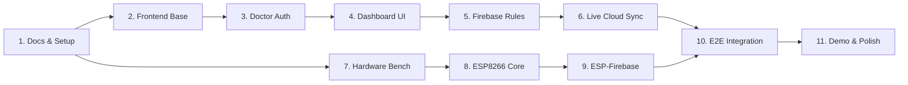

# Phased Development Roadmap: IoT-Based Patient Health Monitoring System

**Document Version:** 1.0.0  
**Status:** Approved Roadmap  
**Target Architecture:** Distributed IoT Edge (ESP8266) + Cloud (Firebase) + Web SPA (React/TS)  

---

## 1. Overview & Phasing Strategy

This roadmap details the systematic, module-by-module implementation plan for the **IoT-Based Patient Health Monitoring System**. Development strictly follows a decoupled engineering methodology:

1. **Phase 1:** Architectural Foundation & Repository Setup (Current Milestone)
2. **Phase 2:** Frontend Foundation & Component Library Setup
3. **Phase 3:** Doctor Authentication Module & Route Protection
4. **Phase 4:** Patient Monitoring Dashboard Layout & Mock UI
5. **Phase 5:** Firebase Configuration & Security Rules Engineering
6. **Phase 6:** Frontend Real-Time Cloud Integration
7. **Phase 7:** Hardware Bench Testing & Sensor Signal Verification
8. **Phase 8:** ESP8266 Firmware Development & Edge Processing
9. **Phase 9:** ESP8266-to-Firebase Cloud Communication
10. **Phase 10:** End-to-End System Integration & Threshold Validation
11. **Phase 11:** Production Build, Documentation Finalization & Demonstration Preparation

---

## Phase 1: Repository Initialization & Architecture Documentation
*Current Phase*

- **Objective:** Establish the foundational Git repository structure, comprehensive engineering specifications, architectural models, database schemas, and hardware verification guidelines before writing application code.
- **Tasks:**
  1. Initialize Git repository with `main` branch.
  2. Create standard folder structure: `docs/`, `frontend/`, `firmware/esp8266/`.
  3. Author `docs/PROJECT_SPEC.md` covering scope, functional requirements, and strict exclusions.
  4. Author `docs/ARCHITECTURE.md` with system design, communication protocols, and Mermaid diagrams.
  5. Author `docs/DEVELOPMENT_PLAN.md` defining step-by-step phased execution.
  6. Author `docs/DATABASE_SCHEMA.md` detailing Realtime Database structures and security models.
  7. Author `docs/HARDWARE.md` specifying component pinouts, ADC scaling, and circuit schematics.
  8. Author `AGENTS.md` setting development boundaries and conventions for AI assistants.
  9. Author `PROGRESS.md` and root `README.md`.
  10. Create project `.gitignore` covering React, Vite, Node, Firebase, and Arduino/ESP8266 artifacts.
- **Dependencies:** None.
- **Expected Output:** Complete documentation suite, initialized Git repository, clean initial commit.
- **Testing Requirements:** Cross-file consistency review, zero dangling links, verification that no secrets or source code have been committed prematurely.
- **Completion Criteria:** Documentation milestone approved by project lead with all checks passing.

---

## Phase 2: Frontend Foundation & Component Library Setup

- **Objective:** Initialize the modern web application scaffolding using Vite, React 18, TypeScript, Tailwind CSS, and shadcn/ui.
- **Tasks:**
  1. Scaffold `frontend/` application using `pnpm create vite . --template react-ts`.
  2. Configure Tailwind CSS with medical/clinical color palette (clean slate/blue tones, distinct alert hues).
  3. Configure path aliases (`@/*` mapping to `src/*`) in `tsconfig.json` and `vite.config.ts`.
  4. Initialize and install core UI components from shadcn/ui: `Card`, `Button`, `Badge`, `Input`, `Table`, `Dialog`, `Alert`.
  5. Install supporting libraries: `lucide-react` for iconography, `clsx` and `tailwind-merge` for utility styling.
  6. Establish basic folder layout (`components/`, `hooks/`, `services/`, `types/`, `config/`).
- **Dependencies:** Phase 1 complete.
- **Expected Output:** Cleanly compiling React + TypeScript project with Tailwind CSS and shadcn/ui ready for module development.
- **Testing Requirements:** Development server boots cleanly (`pnpm run dev`), TypeScript compiles without warnings (`pnpm run build`), no style conflicts.
- **Completion Criteria:** Welcome screen renders with themed shadcn/ui button and card without console errors.

---

## Phase 3: Doctor Authentication Module & Route Protection

- **Objective:** Implement the physician authentication interface, session state manager, and protected route wrappers.
- **Tasks:**
  1. Install Firebase Client SDK (`pnpm add firebase`).
  2. Configure `src/config/firebase.ts` reading from Vite environment variables (`.env.local`).
  3. Create TypeScript auth types and `AuthContext` to expose `currentUser`, `loading`, `login()`, and `logout()`.
  4. Build clinical `LoginForm` component with field validation, accessible error states, and responsive layout.
  5. Implement `ProtectedRoute` component redirecting unauthenticated users to `/login`.
  6. Implement session logout control in navigation header.
- **Dependencies:** Phase 2 complete.
- **Expected Output:** Fully functional login screen that securely authenticates against Firebase Auth and guards dashboard routes.
- **Testing Requirements:**
  - Valid doctor credentials grant access to `/dashboard`.
  - Invalid credentials display friendly, non-technical error notifications.
  - Direct navigation to `/dashboard` while unauthenticated redirects to `/login`.
  - Session persists on page reload.
- **Completion Criteria:** Verified login/logout cycle with persistent Firebase Auth state.

---

## Phase 4: Patient Monitoring Dashboard Layout & Mock UI

- **Objective:** Construct the complete clinical dashboard interface featuring mock data before connecting real cloud streams.
- **Tasks:**
  1. Build `PatientBanner` component displaying Patient Name, ID, Age, Device ID, and Last Updated indicator.
  2. Build `VitalCard` component for Heart Rate (BPM) with dynamic status badge (`NORMAL`, `WARNING`, `ABNORMAL`).
  3. Build `VitalCard` component for Body Temperature (°C) with dynamic status badge.
  4. Build `OverallStatusPill` component computing and displaying collective physiological state.
  5. Build `DeviceStatusIndicator` showing connection state (`ONLINE`, `DEGRADED`, `DISCONNECTED`).
  6. Integrate **Recharts** to build `HeartRateChart` and `TemperatureChart` with reference threshold bands.
  7. Build `AlertFeed` and `AlertHistoryTable` rendering active alerts and chronological audit log.
  8. Assemble complete clinical dashboard layout inside responsive container with mock data generators.
- **Dependencies:** Phase 3 complete.
- **Expected Output:** Pixel-perfect, responsive medical dashboard displaying realistic mock vitals, charts, and alerts.
- **Testing Requirements:** Component renders smoothly on desktop (1920x1080), tablet (768x1024), and mobile (375x667). All status colors and badges change accurately when feeding mock out-of-range values.
- **Completion Criteria:** Visual and structural layout matches clinical healthcare design specifications.

---

## Phase 5: Firebase Configuration & Security Rules Engineering

- **Objective:** Configure Firebase Realtime Database in Singapore (`asia-southeast1`) and deploy strict security rules.
- **Tasks:**
  1. Create `.env.example` defining required Firebase configuration keys (`VITE_FIREBASE_API_KEY`, `VITE_FIREBASE_AUTH_DOMAIN`, `VITE_FIREBASE_DATABASE_URL`, etc.).
  2. Author `database.rules.json` enforcing authenticated-only read access and constrained schema write validation.
  3. Author database initialization script (`scripts/seed_database.json`) populating initial node structure:
     - `/patients/patient_01`
     - `/devices/esp8266_01`
     - `/thresholds/patient_01`
  4. Verify database locked mode allows only authorized operations.
- **Dependencies:** Phase 1 & Phase 3 complete.
- **Expected Output:** Hardened Firebase Realtime Database with deployed security rules and seeded patient/device records.
- **Testing Requirements:** Unauthenticated REST reads return 401 Unauthorized; authenticated client reads succeed; unauthorized write attempts fail.
- **Completion Criteria:** Firebase Rules test passes all permission validation criteria.

---

## Phase 6: Frontend Real-Time Cloud Integration

- **Objective:** Connect the React dashboard components to live Firebase Realtime Database subscriptions.
- **Tasks:**
  1. Create `src/services/firebaseService.ts` containing typed RTDB read/write methods.
  2. Implement `useVitals` custom hook subscribing to `/vitals/latest/patient_01` via `onValue()`.
  3. Implement historical telemetry subscription querying the last 50 entries of `/vitals/history/patient_01`.
  4. Implement `useDevice` hook comparing local timestamp with `/devices/esp8266_01/last_seen` to detect stale data.
  5. Implement `useAlerts` hook subscribing to `/alerts/patient_01` and handling doctor dismissals/acknowledgments.
  6. Replace mock data providers in the dashboard with live hooks.
- **Dependencies:** Phase 4 and Phase 5 complete.
- **Expected Output:** Web dashboard updating instantaneously when data changes in Firebase Realtime Database.
- **Testing Requirements:** Modifying values manually in Firebase Console immediately reflects in the dashboard UI and plots points on charts within 1 second.
- **Completion Criteria:** Real-time data synchronization verified without memory leaks or unhandled promise rejections.

---

## Phase 7: Hardware Bench Testing & Sensor Signal Verification

- **Objective:** Verify electrical characteristics, power supply, and sensor outputs on the breadboard prior to firmware integration.
- **Tasks:**
  1. Inspect NodeMCU ESP8266 board pinout and measure 3.3V rail voltage.
  2. Wire DS18B20 temperature probe: VCC to 3.3V, GND to GND, DATA to D2 (GPIO4) with 4.7kΩ pull-up resistor.
  3. Wire Analog Pulse Sensor: VCC to 3.3V, GND to GND, Signal to A0.
  4. Verify that Pulse Sensor output voltage does not exceed 3.3V under full optical illumination.
  5. Run individual Arduino test sketches:
     - DS18B20 test sketch verifying DallasTemperature reading (°C) over Serial Monitor.
     - Pulse Sensor analog test sketch plotting raw ADC output via Arduino Serial Plotter.
- **Dependencies:** Phase 1 complete.
- **Expected Output:** Validated electrical connections and verified sensor data streaming to Serial Monitor.
- **Testing Requirements:**
  - DS18B20 responds with ambient temperature (~24–28°C) and warms up on finger contact (~35–37°C).
  - Pulse Sensor shows clear rhythmic peaks corresponding to heartbeats when finger is lightly applied.
- **Completion Criteria:** Both sensors provide clean, repeatable readings without electrical anomalies or MCU brownouts.

---

## Phase 8: ESP8266 Firmware Development & Edge Processing

- **Objective:** Develop robust, modular ESP8266 C++ firmware handling dual sensor acquisition and signal filtering.
- **Tasks:**
  1. Structure firmware into modular files:
     - `config.h`: Wi-Fi credentials, Firebase URLs, pin definitions, sample intervals.
     - `sensors_pulse.h / .cpp`: ADC sampling, noise filtering, dynamic thresholding, BPM calculation.
     - `sensors_temp.h / .cpp`: 1-Wire DS18B20 non-blocking temperature acquisition.
  2. Implement non-blocking main loop utilizing `millis()` timers (no blocking `delay()` calls).
  3. Implement Pulse Sensor peak-detection algorithm sampling at 20ms intervals (50 Hz) with moving average smoothing.
  4. Implement DS18B20 read cycle every 3000ms.
  5. Implement local serial telemetry debugging output.
- **Dependencies:** Phase 7 complete.
- **Expected Output:** Standalone C++ firmware continuously computing BPM and temperature with serial output.
- **Testing Requirements:** Firmware runs continuously for 30 minutes without Watchdog Timer (WDT) resets, memory fragmentation, or frozen loops.
- **Completion Criteria:** Valid BPM and temperature values logged stably on Serial Monitor.

---

## Phase 9: ESP8266 to Firebase Cloud Communication

- **Objective:** Connect the ESP8266 to Wi-Fi and publish structured vitals payloads directly to Firebase Realtime Database.
- **Tasks:**
  1. Integrate `ESP8266WiFi` and secure HTTPS client or lightweight Firebase client library.
  2. Implement resilient Wi-Fi connection manager with automatic reconnect logic on link drop.
  3. Implement authenticated Firebase RTDB write routines:
     - Overwrite `/vitals/latest/patient_01` every 3 seconds.
     - Update `/devices/esp8266_01/last_seen` every 3 seconds.
     - Append `/vitals/history/patient_01` every 15 seconds.
  4. Implement error handling for HTTP timeouts and SSL handshake failures.
- **Dependencies:** Phase 5 and Phase 8 complete.
- **Expected Output:** Physical ESP8266 transmitting live physiological data into Firebase Realtime Database in Singapore.
- **Testing Requirements:** Telemetry nodes in Firebase Console update continuously with valid timestamps and values.
- **Completion Criteria:** Continuous 15-minute live telemetry transmission with zero packet corruption.

---

## Phase 10: End-to-End System Integration & Threshold Validation

- **Objective:** Validate the complete hardware-to-cloud-to-dashboard pipeline under real-world operating conditions.
- **Tasks:**
  1. Power the NodeMCU via USB and verify end-to-end telemetry propagation to the doctor dashboard.
  2. Test **NORMAL** operating state: baseline pulse (60–100 BPM) and normal body temperature (36–37°C).
  3. Simulate **WARNING** condition: test elevated heart rate (>100 BPM via exercise) or low/high thermal probe contact.
  4. Simulate **ABNORMAL** condition: verify threshold breach triggers alert creation, visual banner alert, and audit log entry.
  5. Test **Device Disconnection**: Unplug NodeMCU; verify dashboard transitions to `DISCONNECTED / STALE` within 30 seconds.
  6. Reconnect NodeMCU; verify automatic recovery to `ONLINE` state without browser refresh.
- **Dependencies:** Phase 6 and Phase 9 complete.
- **Expected Output:** Fully integrated IoT patient health monitoring prototype demonstrating end-to-end functionality.
- **Testing Requirements:** Comprehensive test execution matrix covering all functional requirements (FR-1 through FR-6).
- **Completion Criteria:** All test cases pass with verified logs and visual demonstrations.

---

## Phase 11: Production Build, Documentation Finalization & Demonstration Prep

- **Objective:** Build production frontend artifacts, compile project reports, and prepare academic presentation assets.
- **Tasks:**
  1. Run production frontend build (`pnpm run build`) and test preview bundle.
  2. Review and finalize all project documentation (`PROJECT_SPEC.md`, `ARCHITECTURE.md`, `HARDWARE.md`, `DATABASE_SCHEMA.md`).
  3. Create high-resolution wiring diagrams and circuit schematics.
  4. Prepare step-by-step demonstration script for academic project evaluation.
  5. Update `PROGRESS.md` to reflect 100% completion across all milestones.
- **Dependencies:** Phase 10 complete.
- **Expected Output:** Production-ready web build, fully documented academic repository, verified demo script.
- **Testing Requirements:** Zero build warnings, clean lighthouse audit, comprehensive documentation verification.
- **Completion Criteria:** Formal sign-off on the completed academic project.
