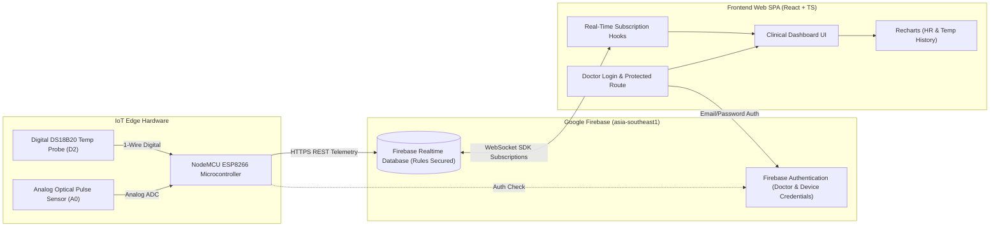

# Session Handoff: IoT-Based Patient Health Monitoring System

**Document Version:** 1.0.0  
**Generated Date:** 2026-11-26  
**Target Audience:** AI Assistants (ChatGPT / Claude / Antigravity), Lead Engineers, and Collaborators  
**Repository Branch:** `main`  
**Current Git HEAD:** `6fbf006757b8413d32a0afdc3a7d07f01aa2570f` (`6fbf006`)  
**Remote URL:** `https://github.com/captainJosh-1/iot-patient-health-monitoring.git`  
**Remote Sync Status:** `main` is completely up to date with `origin/main` (Working tree clean)

---

## 1. Project Overview & Finalized System Scope

The **IoT-Based Patient Health Monitoring System** is an academic engineering capstone prototype engineered to continuously monitor, process, and display real-time physiological vitals from a single monitored patient to an authorized physician via a secure web dashboard.

### 1.1 Strict Scope Boundaries (Mandatory)
The system is explicitly designed with fixed architectural parameters. These boundaries **must never be widened**:
- **Physician Account:** Exactly **one (1)** attending doctor account authenticated via Firebase Authentication.
- **Patient Profile:** Exactly **one (1)** monitored patient record (`patient_01`).
- **Hardware Unit:** Exactly **one (1)** NodeMCU ESP8266 (ESP-12E) microcontroller unit (`esp8266_01`).
- **Physiological Parameters:** Exactly **two (2)** parameters:
  1. **Heart Rate (Photoplethysmography):** Measured in Beats Per Minute (BPM) via an optical pulse sensor (30–220 BPM range).
  2. **Body Temperature (Contact Thermal Sensing):** Measured in Degrees Celsius (°C) via a waterproof Dallas 1-Wire DS18B20 digital sensor (25.0–45.0 °C range).

### 1.2 Prohibited Features (Strict Exclusions)
Do **not** introduce, design, or implement scaffolding for:
- ❌ Fall detection or motion sensing (MPU6050, accelerometers, gyroscopes).
- ❌ Electrocardiogram (ECG) waveforms or front-ends (AD8232).
- ❌ Blood oxygen saturation (SpO2) sensors (MAX30100/MAX30102).
- ❌ Blood pressure or blood glucose monitors.
- ❌ Machine Learning or Artificial Intelligence disease diagnosis or risk prediction.
- ❌ Multi-patient management, patient lists, or hospital ward hierarchies.
- ❌ Patient login portals, family member dashboards, or guest accounts.
- ❌ Appointment scheduling, e-prescriptions, clinical notes, or billing.
- ❌ Auxiliary backend application servers (Express, Fastify, Flask, MongoDB, PostgreSQL, Supabase).

---

## 2. System Architecture & Technology Stack



### Core Technologies
- **Frontend SPA:** Vite 5, React 18, TypeScript, Tailwind CSS, shadcn/ui components, Lucide icons, Recharts for trend charts.
- **Cloud Backend:** Google Firebase Authentication (Email/Password), Google Firebase Realtime Database (Singapore region: `asia-southeast1`).
- **Edge Microcontroller (Firmware):** NodeMCU ESP8266 (ESP-12E module), Arduino C++, non-blocking `millis()` architecture.

---

## 3. Completed Phases & Implemented Features

### Phase 1: Repository Initialization & Architecture Documentation (Completed & Pushed)
- Established directory structure: `docs/`, `frontend/`, `firmware/esp8266/`, `scripts/`.
- Authored comprehensive documentation suite:
  - [`docs/PROJECT_SPEC.md`](file:///c:/Users/cheta/OneDrive/Documents/Patient%20Health%20Monitoring%20System/docs/PROJECT_SPEC.md)
  - [`docs/ARCHITECTURE.md`](file:///c:/Users/cheta/OneDrive/Documents/Patient%20Health%20Monitoring%20System/docs/ARCHITECTURE.md)
  - [`docs/DEVELOPMENT_PLAN.md`](file:///c:/Users/cheta/OneDrive/Documents/Patient%20Health%20Monitoring%20System/docs/DEVELOPMENT_PLAN.md)
  - [`docs/DATABASE_SCHEMA.md`](file:///c:/Users/cheta/OneDrive/Documents/Patient%20Health%20Monitoring%20System/docs/DATABASE_SCHEMA.md)
  - [`docs/HARDWARE.md`](file:///c:/Users/cheta/OneDrive/Documents/Patient%20Health%20Monitoring%20System/docs/HARDWARE.md)
  - [`AGENTS.md`](file:///c:/Users/cheta/OneDrive/Documents/Patient%20Health%20Monitoring%20System/AGENTS.md) (Mandatory AI guidelines & 8-Step Git Protocol)
  - [`README.md`](file:///c:/Users/cheta/OneDrive/Documents/Patient%20Health%20Monitoring%20System/README.md) and [`.gitignore`](file:///c:/Users/cheta/OneDrive/Documents/Patient%20Health%20Monitoring%20System/.gitignore).
- Commit: `8d77ef5` (`docs: initialize patient monitoring project documentation`).

### Phase 2: Frontend Foundation & Component Library Setup (Completed & Pushed)
- Initialized React 18 + TypeScript + Vite project inside `frontend/`.
- Configured Tailwind CSS with custom healthcare color scheme (`slate`, `emerald`, `amber`, `rose`).
- Installed and configured `@/*` path aliases and core shadcn/ui primitives (`Button`, `Card`, `Badge`, `Alert`).
- Commit: `69f00f7` (bundled with Phase 4 UI).

### Phase 3: Doctor Authentication Module & Route Protection (Completed & Pushed)
- Installed `firebase` client SDK.
- Implemented [`frontend/src/services/authService.ts`](file:///c:/Users/cheta/OneDrive/Documents/Patient%20Health%20Monitoring%20System/frontend/src/services/authService.ts) encapsulating `signInWithEmailAndPassword` and `signOut`.
- Implemented [`frontend/src/context/AuthContext.tsx`](file:///c:/Users/cheta/OneDrive/Documents/Patient%20Health%20Monitoring%20System/frontend/src/context/AuthContext.tsx) and [`frontend/src/hooks/useAuth.ts`](file:///c:/Users/cheta/OneDrive/Documents/Patient%20Health%20Monitoring%20System/frontend/src/hooks/useAuth.ts) managing Firebase Auth user state.
- Developed accessible [`frontend/src/components/auth/LoginForm.tsx`](file:///c:/Users/cheta/OneDrive/Documents/Patient%20Health%20Monitoring%20System/frontend/src/components/auth/LoginForm.tsx) with validation and clinical styling.
- Developed [`frontend/src/components/auth/ProtectedRoute.tsx`](file:///c:/Users/cheta/OneDrive/Documents/Patient%20Health%20Monitoring%20System/frontend/src/components/auth/ProtectedRoute.tsx) guarding the dashboard.
- Integrated doctor profile and logout action in [`frontend/src/components/layout/TopNav.tsx`](file:///c:/Users/cheta/OneDrive/Documents/Patient%20Health%20Monitoring%20System/frontend/src/components/layout/TopNav.tsx).
- Commit: `d2e037f` (`feat: implement doctor authentication module and route protection`).

### Phase 4: Patient Monitoring Dashboard Layout & Mock UI (Completed & Pushed)
- Constructed complete responsive clinical dashboard layout in [`frontend/src/pages/DashboardPage.tsx`](file:///c:/Users/cheta/OneDrive/Documents/Patient%20Health%20Monitoring%20System/frontend/src/pages/DashboardPage.tsx).
- Created visual components:
  - [`PatientBanner.tsx`](file:///c:/Users/cheta/OneDrive/Documents/Patient%20Health%20Monitoring%20System/frontend/src/components/dashboard/PatientBanner.tsx) (Demographics, assigned hardware, last updated timestamp).
  - [`VitalCard.tsx`](file:///c:/Users/cheta/OneDrive/Documents/Patient%20Health%20Monitoring%20System/frontend/src/components/dashboard/VitalCard.tsx) (Large telemetry readout, status badges, min/max range indicators).
  - [`OverallStatusBanner.tsx`](file:///c:/Users/cheta/OneDrive/Documents/Patient%20Health%20Monitoring%20System/frontend/src/components/dashboard/OverallStatusBanner.tsx) (Aggregated physiological assessment: `NORMAL`, `WARNING`, `ABNORMAL`).
  - [`DeviceStatusCard.tsx`](file:///c:/Users/cheta/OneDrive/Documents/Patient%20Health%20Monitoring%20System/frontend/src/components/dashboard/DeviceStatusCard.tsx) (NodeMCU connectivity status, last seen counter, firmware info).
  - [`HeartRateChart.tsx`](file:///c:/Users/cheta/OneDrive/Documents/Patient%20Health%20Monitoring%20System/frontend/src/components/dashboard/HeartRateChart.tsx) & [`TemperatureChart.tsx`](file:///c:/Users/cheta/OneDrive/Documents/Patient%20Health%20Monitoring%20System/frontend/src/components/dashboard/TemperatureChart.tsx) (Recharts area/line charts with reference bands).
  - [`AlertsFeed.tsx`](file:///c:/Users/cheta/OneDrive/Documents/Patient%20Health%20Monitoring%20System/frontend/src/components/dashboard/AlertsFeed.tsx) (Active alerts feed, acknowledgment actions, historical alert table).
  - [`ThresholdsModal.tsx`](file:///c:/Users/cheta/OneDrive/Documents/Patient%20Health%20Monitoring%20System/frontend/src/components/dashboard/ThresholdsModal.tsx) (Interactive modal for adjusting clinical demo boundaries).
- Created realistic mock dataset in [`frontend/src/data/mockData.ts`](file:///c:/Users/cheta/OneDrive/Documents/Patient%20Health%20Monitoring%20System/frontend/src/data/mockData.ts).
- Commit: `69f00f7` (`feat: implement patient monitoring dashboard frontend foundation`).

### Phase 5: Firebase Configuration & Security Rules Engineering (Completed & Pushed)
- Engineered and validated complete, production-hardened Firebase Realtime Database security rules in [`database.rules.json`](file:///c:/Users/cheta/OneDrive/Documents/Patient%20Health%20Monitoring%20System/database.rules.json).
- Implemented deletion prevention (`newData.exists()`), doctor-only read/write isolation, authorized device identity binding, and append-only historical telemetry.
- Neutralized database seed structure in [`scripts/seed_database.json`](file:///c:/Users/cheta/OneDrive/Documents/Patient%20Health%20Monitoring%20System/scripts/seed_database.json) (no dummy records or placeholder credentials).
- Updated [`frontend/src/config/firebase.ts`](file:///c:/Users/cheta/OneDrive/Documents/Patient%20Health%20Monitoring%20System/frontend/src/config/firebase.ts) to initialize and export `database: Database` (`getDatabase(app)`).
- Created sanitized environment template in [`frontend/.env.example`](file:///c:/Users/cheta/OneDrive/Documents/Patient%20Health%20Monitoring%20System/frontend/.env.example).
- Validated clean production build (`npm run build` passed with zero errors).
- Commit: `6fbf006` (`feat: implement firebase configuration and security rules`).

---

## 4. Key Source Files & Repository Map

```text
├── database.rules.json               # Hardened Firebase Realtime Database security rules
├── scripts/
│   └── seed_database.json            # Neutral initial Realtime Database seed structure
├── docs/
│   ├── ARCHITECTURE.md               # End-to-end system and security architecture
│   ├── DATABASE_SCHEMA.md            # JSON schema specifications and validation rules
│   ├── DEVELOPMENT_PLAN.md           # 11-phase development roadmap
│   ├── HARDWARE.md                   # Pinouts, electrical schematics, ADC calculations
│   ├── PROJECT_SPEC.md               # Scope, functional/non-functional requirements
│   └── SESSION_HANDOFF.md            # This handoff document
├── frontend/
│   ├── .env.example                  # Environment variable template
│   ├── .env.local                    # Local environment variables (GITIGNORED - DO NOT COMMIT)
│   ├── package.json                  # Dependencies: firebase, react, recharts, tailwindcss
│   ├── src/
│   │   ├── config/
│   │   │   └── firebase.ts           # Firebase app, auth, and database initialization
│   │   ├── context/
│   │   │   └── AuthContext.tsx       # Auth provider and state context
│   │   ├── hooks/
│   │   │   └── useAuth.ts            # Hook exposing currentUser, login, logout
│   │   ├── services/
│   │   │   └── authService.ts        # Firebase Authentication wrapper
│   │   ├── components/
│   │   │   ├── auth/                 # LoginForm, ProtectedRoute
│   │   │   ├── dashboard/            # PatientBanner, VitalCard, HeartRateChart, etc.
│   │   │   ├── layout/               # DashboardLayout, TopNav, Sidebar
│   │   │   └── ui/                   # Reusable UI primitives (alert, badge, button, card)
│   │   ├── lib/
│   │   │   ├── thresholdEvaluator.ts # Logic for NORMAL / WARNING / ABNORMAL status
│   │   │   └── utils.ts              # Styling utilities (cn helper)
│   │   ├── pages/
│   │   │   └── DashboardPage.tsx     # Central dashboard orchestrator
│   │   └── types/                    # Strong TS interfaces (patient, vitals, device, alerts)
└── firmware/
    └── esp8266/
        └── README.md                 # Firmware guidelines for upcoming Phase 8 & 9
```

---

## 5. Firebase Configuration, Security Rules & Seed Architecture

### 5.1 Environment Variables (`frontend/.env.example`)
```ini
VITE_FIREBASE_API_KEY=your_firebase_api_key_here
VITE_FIREBASE_AUTH_DOMAIN=your_project_id.firebaseapp.com
VITE_FIREBASE_DATABASE_URL=https://your_project_id-default-rtdb.asia-southeast1.firebasedatabase.app
VITE_FIREBASE_PROJECT_ID=your_project_id
VITE_FIREBASE_STORAGE_BUCKET=your_project_id.firebasestorage.app
VITE_FIREBASE_MESSAGING_SENDER_ID=your_messaging_sender_id
VITE_FIREBASE_APP_ID=your_app_id
VITE_FIREBASE_MEASUREMENT_ID=your_measurement_id_optional
```

### 5.2 Realtime Database Security Model (`database.rules.json`)
The complete security architecture operates on a strict **principle of least privilege**:

1. **Default Closed:**
   - Root rules define `".read": false` and `".write": false`.
   - No broad parent writes exist; intermediate paths (`/patients`, `/devices`, `/vitals`, `/alerts`, `/thresholds`) grant access strictly at leaf IDs.
2. **Doctor Registry (`/doctors/{doctorId}`):**
   - `.read`: Allowed only when `auth.uid === $doctorId`.
   - `.write`: Set to `false`. Registration is an administrative process (Firebase Console / Admin SDK). Self-promotion is impossible.
3. **Authorized Device Mapping (`/authorized_devices/{deviceAuthUid}`):**
   - Maps the device's Firebase Auth UID to its hardware ID and assigned patient ID:
     ```json
     {
       "deviceId": "esp8266_01",
       "assignedPatientId": "patient_01"
     }
     ```
   - `.read`: Authorized doctors OR the device itself (`auth.uid === $deviceAuthUid`).
   - `.write`: Set to `false`. Admin-provisioned only.
4. **Patient Demographics (`/patients/{patientId}`):**
   - `.read`: Registered doctors only (`root.child('doctors').child(auth.uid).exists()`).
   - `.write`: Registered doctors only with `newData.exists()`. Deletion is prohibited.
   - `.validate`: Requires `patientId`, `fullName`, `age` (0–130), `gender` (`Female` | `Male` | `Other`), `assignedDeviceId`, `registeredAt`. Optional `contactNumber` string.
5. **Device State & Heartbeat (`/devices/{deviceId}`):**
   - `.read`: Registered doctors only.
   - `.write`: Registered doctors OR authorized device where `authorized_devices[auth.uid].deviceId === $deviceId`. Deletion blocked via `newData.exists()`.
   - `.validate`: Validates `deviceId`, numeric `lastSeen`, and constrained status (`ONLINE` or `STANDBY`). Devices cannot report `OFFLINE` (the frontend infers `OFFLINE` when `Date.now() - lastSeen > 30000` ms).
6. **Latest Vitals (`/vitals/latest/{patientId}`):**
   - `.read`: Registered doctors only. Devices cannot read latest vitals.
   - `.write`: Doctors OR authorized device where `authorized_devices[auth.uid].assignedPatientId === $patientId` AND `authorized_devices[auth.uid].deviceId === newData.child('deviceId').val()`. Deletion blocked.
   - `.validate`: Physiological limits: `heartRate` (30–220 BPM), `temperature` (25.0–45.0 °C), numeric `timestamp`.
7. **Historical Vitals (`/vitals/history/{patientId}/{timestampId}`):**
   - `.read`: Registered doctors only.
   - `.write`: Strictly append-only: requires `!data.exists() && newData.exists()`. Updates and deletions are blocked.
   - `.validate`: Numeric `timestamp`, `heartRate` (30–220 BPM), `temperature` (25.0–45.0 °C). Indexed on `timestamp`.
8. **Clinical Alerts (`/alerts/{patientId}/{alertId}`):**
   - `.read`: Registered doctors only. Devices have zero access to alerts.
   - `.write`: Registered doctors only with `newData.exists()`. Deletion blocked.
   - `.validate`: Two states only:
     - **Creation:** `!data.exists()`, valid enums (`HEART_RATE` | `TEMPERATURE`, `WARNING` | `ABNORMAL`), initial `acknowledged === false`, no `acknowledgedAt`.
     - **Acknowledgment:** `data.exists()`, all original fields immutable, one-way state transition (`false -> true`), required numeric `acknowledgedAt`. Indexed on `timestamp`, `severity`, `acknowledged`.
9. **Clinical Demo Thresholds (`/thresholds/{patientId}`):**
   - `.read`: Registered doctors only.
   - `.write`: Registered doctors only with `newData.exists()`.
   - `.validate`: All 8 thresholds numeric with strict logical ordering: `MinWarning < MinNormal < MaxNormal < MaxWarning`.

### 5.3 Initial Seed Structure (`scripts/seed_database.json`)
```json
{
  "patients": {},
  "devices": {
    "esp8266_01": {
      "deviceId": "esp8266_01",
      "status": "STANDBY",
      "lastSeen": 0
    }
  },
  "vitals": {
    "latest": {},
    "history": {}
  },
  "alerts": {}
}
```

---

## 6. Git Status, Commit History & Remote Push Status

- **Active Branch:** `main`
- **Current HEAD Commit:** `6fbf006757b8413d32a0afdc3a7d07f01aa2570f` (`6fbf006`)
- **Remote Tracking:** `origin/main` is identical to local `main`.
- **Working Tree:** Clean (zero unstaged changes, zero untracked files).

### Milestone Commit History
1. `8d77ef5`: `docs: initialize patient monitoring project documentation` (Phase 1)
2. `69f00f7`: `feat: implement patient monitoring dashboard frontend foundation` (Phases 2 & 4)
3. `d2e037f`: `feat: implement doctor authentication module and route protection` (Phase 3)
4. `6fbf006`: `feat: implement firebase configuration and security rules` (Phase 5)

---

## 7. Implementation, Verification & Deployment Status Matrix

| Component / Layer | Implemented | Locally Tested | Committed to Git | Pushed to GitHub | Deployed / Live in Firebase |
| :--- | :---: | :---: | :---: | :---: | :---: |
| **Phase 1: Architecture Documentation** | ✅ Yes | ✅ Yes | ✅ Yes (`8d77ef5`) | ✅ Yes | N/A |
| **Phase 2: Frontend Foundation & shadcn/ui** | ✅ Yes | ✅ Yes | ✅ Yes (`69f00f7`) | ✅ Yes | N/A |
| **Phase 3: Doctor Auth & Protected Routes** | ✅ Yes | ✅ Yes (Browser verified) | ✅ Yes (`d2e037f`) | ✅ Yes | Partial (Auth user exists) |
| **Phase 4: Clinical Dashboard & Mock UI** | ✅ Yes | ✅ Yes (Responsive test) | ✅ Yes (`69f00f7`) | ✅ Yes | N/A |
| **Phase 5: Database Rules & Seed Schema** | ✅ Yes | ✅ Yes (`npm run build`) | ✅ Yes (`6fbf006`) | ✅ Yes | ⚠️ Pending deployment |
| **Phase 6: Live Cloud Synchronization Hooks** | ❌ No | ❌ No | ❌ No | ❌ No | ❌ No |
| **Phases 7–9: Hardware & ESP8266 Firmware** | ❌ No | ❌ No | ❌ No | ❌ No | ❌ No |
| **Phases 10–11: E2E Integration & Demo Prep** | ❌ No | ❌ No | ❌ No | ❌ No | ❌ No |

### Manually Confirmed Firebase Console Status (Crucial Context)
The human developer has confirmed the following current state in the live Firebase Console:
1. **Doctor Authentication Account:** Exists in Firebase Authentication (Email/Password provider enabled).
2. **Doctor Registry Node:** The doctor's actual Firebase Auth UID has been manually added in Realtime Database under `/doctors/{doctor_uid}` with doctor profile metadata.
3. **Security Rules:** The contents of [`database.rules.json`](file:///c:/Users/cheta/OneDrive/Documents/Patient%20Health%20Monitoring%20System/database.rules.json) have been pasted into the Firebase Realtime Database Rules tab in the console.
4. **Rules Publication:** Clicking **Publish** has **not yet been confirmed**.
5. **Seed Database Import:** [`scripts/seed_database.json`](file:///c:/Users/cheta/OneDrive/Documents/Patient%20Health%20Monitoring%20System/scripts/seed_database.json) has **not** been imported into the live database.
6. **Live Frontend Connection:** Live Firebase Realtime Database integration has **not** started (the dashboard currently still uses mock data).

---

## 8. Remaining Phased Roadmap

- **Phase 6: Frontend Real-Time Cloud Integration**
  - Implement `src/services/firebaseService.ts` for typed RTDB operations.
  - Implement custom subscription hooks: `useVitals`, `useDevice`, `useAlerts`, `useHistory`.
  - Connect dashboard UI components to real-time Firebase listeners.
  - Test live updates when modifying values in Firebase Console.
- **Phase 7: Hardware Bench Testing & Sensor Signal Verification**
  - Breadboard wiring of NodeMCU ESP8266, Pulse Sensor (A0), and DS18B20 (D2).
  - Verify 3.3V rail voltage and analog voltage compliance (< 3.3V).
  - Serial monitor validation of pulse peaks and thermal readings.
- **Phase 8: ESP8266 Firmware Development & Edge Processing**
  - Author modular C++ firmware: `config.h`, `sensors_pulse.cpp`, `sensors_temp.cpp`.
  - Implement non-blocking 50 Hz pulse sampling and 3-second thermal sampling using `millis()`.
- **Phase 9: ESP8266 to Firebase Cloud Communication**
  - Implement Wi-Fi reconnect manager and HTTPS REST publisher to Singapore RTDB.
  - Transmit latest vitals every 3 seconds, heartbeat every 3 seconds, history every 15 seconds.
- **Phase 10: End-to-End System Integration & Threshold Validation**
  - Full hardware-to-cloud-to-dashboard validation.
  - Verify `NORMAL`, `WARNING`, and `ABNORMAL` state transitions and alert generation.
  - Verify 30-second offline detection when NodeMCU is unplugged.
- **Phase 11: Production Build, Documentation Finalization & Demo Prep**
  - Final bundle optimization, presentation scripts, and academic demonstration audit.

---

## 9. Exact Current Stopping Point & The Immediate Next Action

### Current Stopping Point
Phase 5 is 100% complete, verified, committed (`6fbf006`), and pushed to GitHub. The project workspace is completely clean. The live Firebase Console has the doctor account and `/doctors/{auth.uid}` entry set up, and the rules pasted into the editor.

### The Immediate Next Action
When starting the next conversation, the exact next step is to **transition from Phase 5 setup to Phase 6 implementation**:

1. **Confirm Firebase Console Setup:**
   - Verify that the security rules in the Firebase Realtime Database Rules tab have been **Published**.
   - Import [`scripts/seed_database.json`](file:///c:/Users/cheta/OneDrive/Documents/Patient%20Health%20Monitoring%20System/scripts/seed_database.json) into the Realtime Database using the Firebase Console **Import JSON** button (or verify initial root nodes).
2. **Begin Phase 6 (Frontend Real-Time Cloud Integration):**
   - Create [`frontend/src/services/firebaseService.ts`](file:///c:/Users/cheta/OneDrive/Documents/Patient%20Health%20Monitoring%20System/frontend/src/services/firebaseService.ts) to provide typed listeners (`onValue`, `get`, `set`, `update`) for:
     - `/vitals/latest/{patientId}`
     - `/vitals/history/{patientId}`
     - `/devices/{deviceId}`
     - `/alerts/{patientId}`
     - `/thresholds/{patientId}`
   - Implement custom React hooks in `frontend/src/hooks/`:
     - `useVitals.ts`: Real-time subscription to latest Heart Rate and Temperature.
     - `useDevice.ts`: Real-time subscription to device status, calculating `OFFLINE` if `Date.now() - lastSeen > 30000` ms.
     - `useAlerts.ts`: Real-time subscription to active alerts with acknowledgment handler.
     - `useHistory.ts`: Querying historical readings for Recharts.
   - Replace mock data providers in [`frontend/src/pages/DashboardPage.tsx`](file:///c:/Users/cheta/OneDrive/Documents/Patient%20Health%20Monitoring%20System/frontend/src/pages/DashboardPage.tsx) with these live Firebase hooks.
   - Test by modifying telemetry in Firebase Console and observing instant sub-second dashboard UI updates.
